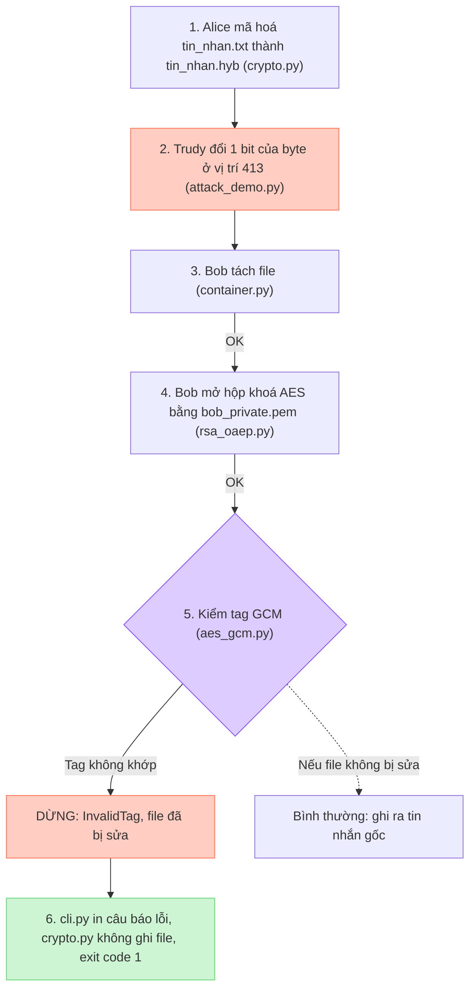
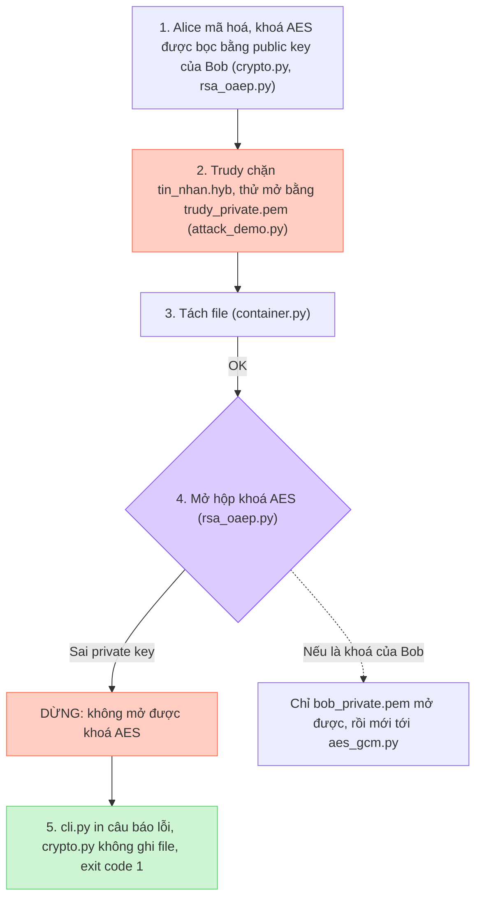

# Demo Tấn công 1 và Tấn công 2 của Trudy

File demo: `demo/attack_demo.py` (branch `khoi`, làm dựa trên `complete_tasks`).

Script này **không sửa** code nào có sẵn. Nó chỉ gọi lại đúng các file trong `hybridcrypto/`, rồi in ra từng bước file nào đang chạy và file nào chặn Trudy.

Mỗi tấn công được chạy 2 lần:

1. **Từng bước:** làm lại đúng thứ tự trong `crypto.decrypt_file`, mỗi dòng ghi rõ file nào chịu trách nhiệm.
2. **Lệnh thật:** chạy đúng lệnh `python3 -m hybridcrypto.cli decrypt ...` mà người dùng gõ, để thấy chương trình thật báo lỗi gì và không ghi ra file nào.

Mọi file của demo (khoá, file `.hyb`) nằm trong `demo/output_tan_cong/`. Thư mục này có `.gitignore` riêng nên không bao giờ lên GitHub.


## 1. Chuẩn bị (làm một lần)

```bash
git switch khoi
git pull
pip install -r requirements.txt
python3 -m pytest
```

Lệnh cuối phải ra `32 passed`.


## 2. Lệnh để demo

Chạy ở thư mục gốc của repo. Có `--pause` thì chương trình dừng sau mỗi bước, bấm Enter để đi tiếp, rất hợp lúc thuyết trình.

```bash
# Bước chuẩn bị: Bob và Trudy tạo khoá, Alice mã hoá, Bob giải mã bình thường
python3 demo/attack_demo.py setup --pause

# Tấn công 1: Trudy sửa 1 bit trên đường đi
python3 demo/attack_demo.py attack1 --pause

# Tấn công 2: Trudy dùng private key của Trudy
python3 demo/attack_demo.py attack2 --pause
```

Muốn chạy hết một mạch (để tập dượt):

```bash
python3 demo/attack_demo.py all
```

Nếu chưa chạy `setup` mà gõ thẳng `attack1` hay `attack2` thì script tự chạy `setup` trước.

Nếu thầy hỏi "sửa chỗ khác trong file thì sao", đổi vị trí byte bằng `--byte`:

```bash
python3 demo/attack_demo.py attack1 --byte 100   # sửa trong hộp khoá AES: rsa_oaep.py chặn
python3 demo/attack_demo.py attack1 --byte 0     # sửa chữ HYBR ở đầu file: container.py chặn
python3 demo/attack_demo.py attack1 --byte 480   # sửa ngay cái tag: aes_gcm.py chặn
```

Trên Windows thì gõ `python` thay cho `python3`.


## 3. Workflow Tấn công 1: Trudy sửa file trên đường đi



| Giai đoạn | Chuyện gì xảy ra | File chịu trách nhiệm | Kết quả |
| --- | --- | --- | --- |
| Chuẩn bị khoá | Bob và Trudy mỗi người tạo một cặp khoá RSA 3072 bit | `hybridcrypto/rsa_oaep.py` | OK |
| Alice mã hoá | Tạo khoá AES, mã tin nhắn, bọc khoá AES bằng public key của Bob, đóng gói | `hybridcrypto/crypto.py` (gọi `aes_gcm.py`, `rsa_oaep.py`, `container.py`) | `tin_nhan.hyb`, 486 byte |
| Trudy sửa file | Đổi đúng 1 bit của byte ở vị trí 413 (nằm trong vùng nội dung đã mã) | `demo/attack_demo.py` (hàm `attack1`) | `tin_nhan_bi_sua.hyb` |
| Bob tách file | Kiểm chữ HYBR và version, tách ra hộp khoá, nonce, nội dung | `hybridcrypto/container.py` | OK, vì Trudy không đụng phần này |
| Bob mở hộp khoá | Dùng `bob_private.pem` lấy lại khoá AES | `hybridcrypto/rsa_oaep.py` | OK, vì hộp khoá còn nguyên |
| Kiểm tag | Giải mã và kiểm con tem niêm phong 16 byte | `hybridcrypto/aes_gcm.py` | **DỪNG**: `InvalidTag` |
| Báo lỗi | Bắt `InvalidTag`, in câu tiếng Việt, trả exit code 1 | `hybridcrypto/cli.py` | `Error: xác thực thất bại: file .hyb đã bị sửa hoặc bị hỏng` |
| Không ghi file | Chỉ ghi file ra khi mọi bước đều qua | `hybridcrypto/crypto.py` | Không có file nào được tạo |

=> Trudy không đọc được, mà sửa lén cũng không được. Bob luôn biết file có bị đụng vào hay không.


## 4. Workflow Tấn công 2: Trudy dùng private key của mình



| Giai đoạn | Chuyện gì xảy ra | File chịu trách nhiệm | Kết quả |
| --- | --- | --- | --- |
| Chuẩn bị | Giống Tấn công 1: tạo khoá, Alice mã hoá cho Bob | `hybridcrypto/rsa_oaep.py`, `hybridcrypto/crypto.py` | `tin_nhan.hyb` |
| Trudy chặn file | Lấy file `.hyb` thật, không sửa gì, dùng `trudy_private.pem` | `demo/attack_demo.py` (hàm `attack2`) | |
| Tách file | Kiểm chữ HYBR và version, tách ra 3 phần | `hybridcrypto/container.py` | OK, file còn nguyên |
| Mở hộp khoá | Thử mở hộp khoá AES bằng private key của Trudy | `hybridcrypto/rsa_oaep.py` (hàm `unwrap_key`) | **DỪNG**: không mở được khoá AES |
| Báo lỗi | Bắt lỗi, in câu tiếng Việt, trả exit code 1 | `hybridcrypto/cli.py` | `Error: không mở được khoá AES: private key này không phải của người nhận, ...` |
| Không ghi file | Chưa tới bước giải mã nên không có gì để ghi | `hybridcrypto/crypto.py` | Không có file nào được tạo |

=> Khoá AES được bọc cho Bob, nên chỉ private key của Bob mở được. Khoá của ai khác cũng vô dụng.

Ghi chú: trong video lỗi hiện là `ValueError: Decryption failed`. Code bây giờ đổi lỗi đó thành câu tiếng Việt ở trên (trong `rsa_oaep.py`), ý nghĩa vẫn y như cũ.


## 5. Output thật khi chạy

Khoá và byte là ngẫu nhiên nên mỗi lần chạy số sẽ khác một chút, nhưng chỗ OK và chỗ DỪNG luôn giống vầy.

**Tấn công 1:**

```
TẤN CÔNG 1: Trudy sửa 1 bit của file .hyb trên đường đi
  Trudy đổi byte ở vị trí 413, thuộc vùng nội dung đã mã (ciphertext): ff thành fe, lệch đúng 1 bit
  Rồi gửi tiếp cho Bob: demo/output_tan_cong/tin_nhan_bi_sua.hyb

  Bob giải mã từng bước, đúng thứ tự trong hybridcrypto/crypto.py (hàm decrypt_file):
  OK   [hybridcrypto/container.py] Tách file: đúng chữ HYBR, đúng version, ra 3 phần
  OK   [hybridcrypto/rsa_oaep.py] Mở hộp khoá AES bằng bob_private.pem: lấy được khoá 75 29 e2 ad ...
  DỪNG [hybridcrypto/aes_gcm.py] Kiểm tag GCM: tag KHÔNG khớp, file đã bị sửa (InvalidTag)

  Chạy đúng lệnh thật Bob sẽ gõ:
  $ python3 -m hybridcrypto.cli decrypt --in demo/output_tan_cong/tin_nhan_bi_sua.hyb --out demo/output_tan_cong/bob_doc_file_bi_sua.txt --privkey demo/output_tan_cong/bob_private.pem
    Error: xác thực thất bại: file .hyb đã bị sửa hoặc bị hỏng
  Exit code: 1 (0 là thành công, 1 là bị chặn)
  Không có file demo/output_tan_cong/bob_doc_file_bi_sua.txt nào được ghi ra
```

**Tấn công 2:**

```
TẤN CÔNG 2: Trudy dùng private key của Trudy để mở file
  Trudy chặn được demo/output_tan_cong/tin_nhan.hyb (file thật, không sửa gì).
  Trudy có private key thật: trudy_private.pem, nhưng khoá AES trong file được bọc cho Bob.

  Trudy giải mã từng bước, đúng thứ tự trong hybridcrypto/crypto.py (hàm decrypt_file):
  OK   [hybridcrypto/container.py] Tách file: đúng chữ HYBR, đúng version, ra 3 phần
  DỪNG [hybridcrypto/rsa_oaep.py] Mở hộp khoá AES bằng trudy_private.pem: không mở được khoá AES: private key này không phải của người nhận, hoặc phần khoá bọc trong file đã bị sửa

  Chạy đúng lệnh thật Trudy sẽ gõ:
  $ python3 -m hybridcrypto.cli decrypt --in demo/output_tan_cong/tin_nhan.hyb --out demo/output_tan_cong/trudy_doc_trom.txt --privkey demo/output_tan_cong/trudy_private.pem
    Error: không mở được khoá AES: private key này không phải của người nhận, hoặc phần khoá bọc trong file đã bị sửa
  Exit code: 1 (0 là thành công, 1 là bị chặn)
  Không có file demo/output_tan_cong/trudy_doc_trom.txt nào được ghi ra
```


## 6. Nếu thầy muốn xem bằng lệnh tay (không dùng script)

Mấy lệnh này chỉ dùng chương trình chính, không đụng tới `attack_demo.py`. File để trong `keys/` nên cũng không lên GitHub.

```bash
# Bob và Trudy tạo khoá
python3 -m hybridcrypto.cli keygen --out keys/bob
python3 -m hybridcrypto.cli keygen --out keys/trudy

# Alice mã hoá cho Bob
python3 -m hybridcrypto.cli encrypt --in samples/sample.txt --out keys/tin_nhan.hyb --pubkey keys/bob/public.pem

# Tấn công 1: Trudy đổi 1 bit của byte ở vị trí 413, rồi Bob giải mã
python3 -c "d=bytearray(open('keys/tin_nhan.hyb','rb').read()); d[413]^=1; open('keys/tin_nhan_bi_sua.hyb','wb').write(d)"
python3 -m hybridcrypto.cli decrypt --in keys/tin_nhan_bi_sua.hyb --out keys/ket_qua.txt --privkey keys/bob/private.pem

# Tấn công 2: Trudy mở file thật bằng private key của Trudy
python3 -m hybridcrypto.cli decrypt --in keys/tin_nhan.hyb --out keys/ket_qua.txt --privkey keys/trudy/private.pem

# Đối chứng: Bob mở file thật bằng khoá của Bob thì được
python3 -m hybridcrypto.cli decrypt --in keys/tin_nhan.hyb --out keys/ket_qua.txt --privkey keys/bob/private.pem

# Dọn dẹp
rm -r keys/bob keys/trudy keys/tin_nhan.hyb keys/tin_nhan_bi_sua.hyb keys/ket_qua.txt
```

Nếu `keygen` báo khoá đã tồn tại thì chạy lệnh dọn dẹp trước rồi làm lại.
